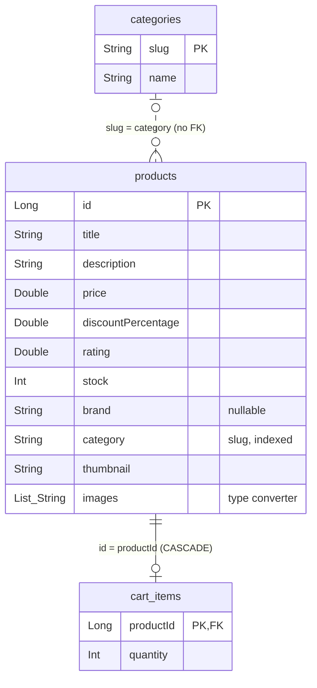

# Wittix – Product Catalog

Android product catalog app built with Jetpack Compose on top of the [DummyJSON](https://dummyjson.com/) API.

## Screenshots

| Product list | Product detail | Cart |
|:---:|:---:|:---:|
|  |  |  |

### Dark theme

| Product list | Product detail | Cart |
|:---:|:---:|:---:|
|  |  |  |

### Landscape

| Product list | Product detail | Cart |
|:---:|:---:|:---:|
|  |  |  |

## Features

- **Product list** – adaptive grid, infinite scroll (pages of 20), search (300 ms debounce) and category filter chips.
  Search bar and chips hide while scrolling down and reappear on scroll up.
  The price row in each card uses `FlowRow`, so long prices wrap onto a new line instead of being squeezed or cut.
  Tradeoff: cards in the adaptive `LazyVerticalGrid` can have different heights when text is longer than usual.
- **Product detail** – hero image, price/discount, rating, stock, brand and description. Add to cart.
- **Cart** – change quantity, remove item, clear cart, live total. Cart badge on the list screen.
- **Sync**
  - **Offline first** – products, categories and cart are stored in Room; the UI shows cached data right away and the network only refreshes it.
  - **Progress bar** – a thin bar below the top bar shows while syncing, until the updated data arrives.
  - **Retry** – if sync fails, an error row with **Retry** appears over the cached data.
- **Animations**
  - **Transitions** – shared element image transition from list to detail.
  - **Slide** – search bar and filter chips slide away on scroll down and back on scroll up.
  - **Delete** – cart items animate out when removed.
- **Dark theme** – follows the system setting.

## Tech stack

| Area | Library |
|------|---------|
| UI | Jetpack Compose, Material 3 |
| Navigation | Navigation Compose (type-safe routes, kotlinx.serialization) |
| DI | Koin |
| Network | Retrofit, OkHttp, Moshi |
| Local storage | Room |
| Images | Coil 3 |
| Async | Kotlin Coroutines / Flow |

## Architecture

MVVM with **Unidirectional Data Flow (UDF)**: state flows down, events flow up.

- Each ViewModel exposes a single immutable `UiState` as a `StateFlow`.
- Screens are stateless `*Content` composables: they render `UiState` and send user events up as callbacks (`onRemove`, `onQueryChange`, …).
- Only the ViewModel changes state, so the UI is a pure function of state and easy to preview and test.

```
User event → ViewModel → Repository → Room Flow → UiState → Compose UI
     ↑                                                          │
     └──────────────────────────────────────────────────────────┘
```

Layering:

```
ui/          Compose screens, ViewModels, UiState, reusable components, navigation
domain/      Models and repository interfaces
data/        Repositories, Retrofit API (remote), Room DAOs/entities (local)
mappers/     Remote ↔ local ↔ domain mappings
di/          Koin modules
theme/       Colors and Material theme
```

Data flow: ViewModel → repository → Room `Flow` → `UiState` → Compose.
Network calls (`loadPage`, `refreshCategories`, …) write into Room and return a `Result`, so errors become UI state instead of crashes.
Data state (Room rows) and sync state (`isLoading`, `error`) are separate `UiState` fields, rendered by the shared `SyncStatus` component.

## Database

Room schema (version 1):



- `cart_items.productId` is a foreign key with `ON DELETE CASCADE`: deleting a product removes it from the cart.
- `products.category` holds the category slug (e.g. `mens-shirts`), the same value as `categories.slug`.
  There is no foreign key, so products can sync before categories.
- Product detail loads the category with Room `@Relation` (`ProductWithCategory`) to show its display name.
  Until categories are cached, it falls back to the slug.

### Server changes

Products sync by upsert, so cached product rows update but are never deleted.
Categories come as one full list, so `CategoryDao.replaceAll` deletes slugs missing from it and upserts the rest in one transaction:

| Server change | Room eventually? | When |
|---|---|---|
| Move product to another category | ✅ Updated | Next time a page with that product loads; upsert overwrites `category`. |
| Edit product (price, title…) | ✅ Updated | Next page load or detail open. |
| Rename category | ✅ Updated | Next `refreshCategories()`, i.e. next app start. |
| Delete a product | ❌ Never removed | Upsert never deletes; the row stays cached. |
| Delete a category | ✅ Removed | Next `refreshCategories()`; its chip disappears. Its products stay cached. |

Updates reach only products the user loads again; products on pages never revisited keep old data.

## Requirements

- Android Studio with AGP 9.4+
- JDK 17+
- minSdk 26, targetSdk 37

## Build & run

```bash
./gradlew :app:installDebug
```

Or open the project in Android Studio and run the `app` configuration.

## Tests

Unit tests cover the ViewModels (product list, product detail, cart) and `ProductsRepository`.

```bash
./gradlew :app:testDebugUnitTest
```
