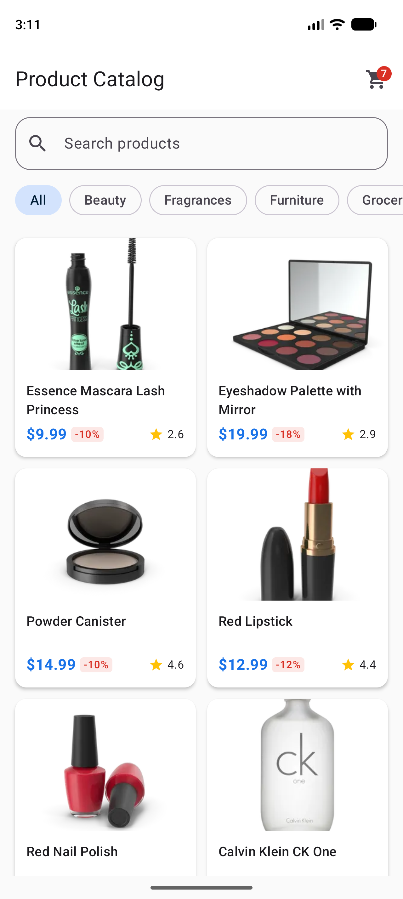
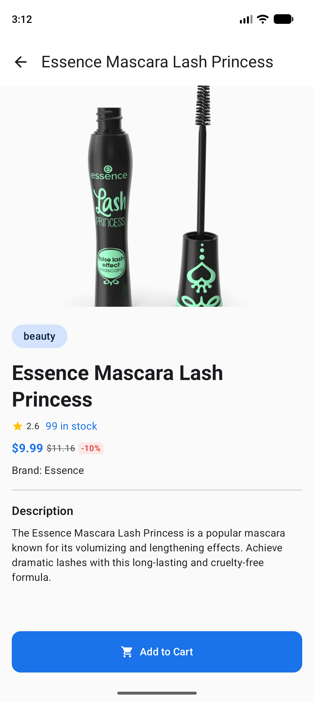
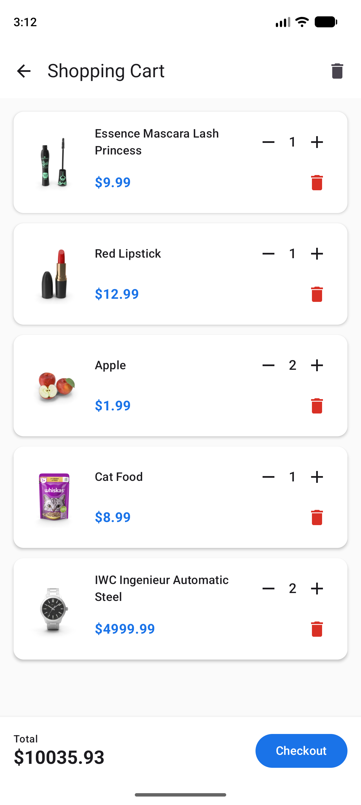
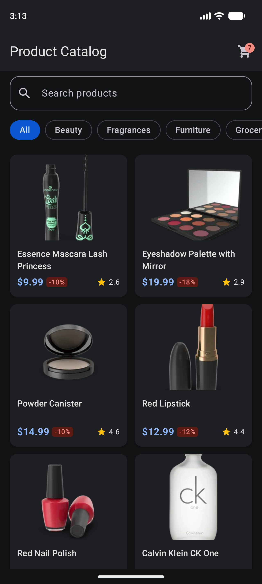
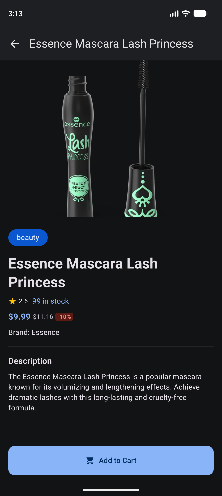
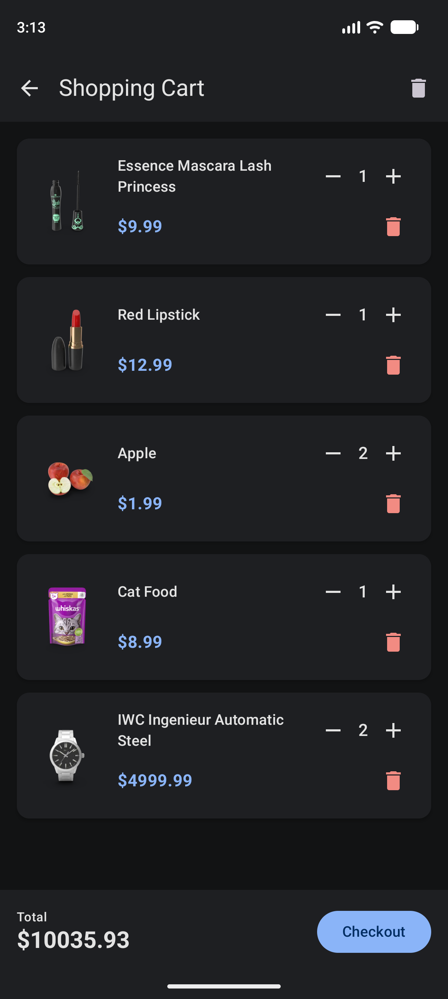
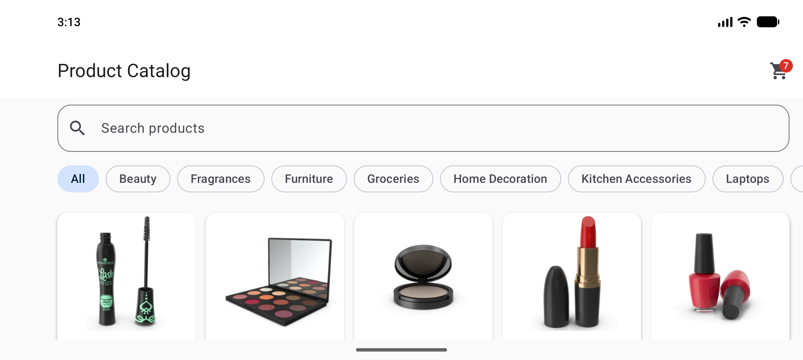
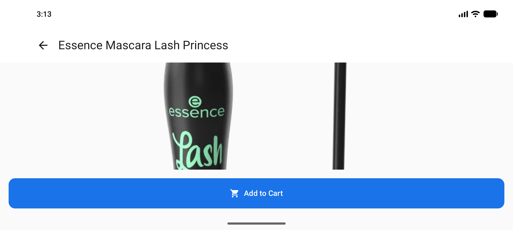
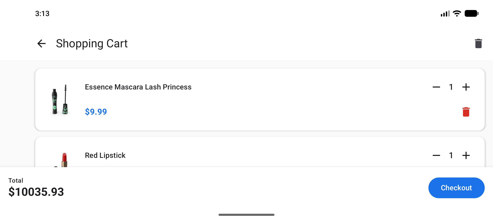

# Wittix – Product Catalog

Android product catalog app built with Jetpack Compose on top of the [DummyJSON](https://dummyjson.com/) API.

## Screenshots

| Product list | Product detail | Cart |
|:---:|:---:|:---:|
|  |  |  |

### Dark theme

| Product list | Product detail | Cart |
|:---:|:---:|:---:|
|  |  |  |

### Landscape

| Product list | Product detail | Cart |
|:---:|:---:|:---:|
|  |  |  |

## Features

- **Product list** – adaptive grid, infinite scroll (pages of 20), search (300 ms debounce) and category filter chips.
  Search bar and chips hide while scrolling down and reappear on scroll up.
- **Product detail** – hero image, price/discount, rating, stock, brand and description. Add to cart.
- **Cart** – change quantity, remove item, clear cart, live total. Cart badge on the list screen.
- **Offline first** – products, categories and cart are stored in Room; the UI observes the database and network only refreshes it.
  Cached data stays visible when a refresh fails, with a retry option.
- **Animations** – shared element image transition from list to detail; animated item removal in the cart.
- **Dark theme** – follows the system setting.

## Tech stack

| Area | Library |
|------|---------|
| UI | Jetpack Compose, Material 3 |
| Navigation | Navigation Compose (type-safe routes, kotlinx.serialization) |
| DI | Koin |
| Network | Retrofit, OkHttp, Moshi |
| Local storage | Room |
| Images | Coil 3 |
| Async | Kotlin Coroutines / Flow |

## Architecture

MVVM with **Unidirectional Data Flow (UDF)**: state flows down, events flow up.

- Each ViewModel exposes a single immutable `UiState` as a `StateFlow`.
- Screens are stateless `*Content` composables: they render `UiState` and send user events up as callbacks (`onRemove`, `onQueryChange`, …).
- Only the ViewModel changes state, so the UI is a pure function of state and easy to preview and test.

```
User event → ViewModel → Repository → Room Flow → UiState → Compose UI
     ↑                                                          │
     └──────────────────────────────────────────────────────────┘
```

Layering:

```
ui/          Compose screens, ViewModels, UiState, reusable components, navigation
domain/      Models and repository interfaces
data/        Repositories, Retrofit API (remote), Room DAOs/entities (local)
mappers/     Remote ↔ local ↔ domain mappings
di/          Koin modules
theme/       Colors and Material theme
```

Data flow: ViewModel → repository → Room `Flow` → `UiState` → Compose.
Network calls (`loadPage`, `refreshCategories`, …) write into Room and return a `Result`, so errors become UI state instead of crashes.

## Requirements

- Android Studio with AGP 9.4+
- JDK 17+
- minSdk 26, targetSdk 37

## Build & run

```bash
./gradlew :app:installDebug
```

Or open the project in Android Studio and run the `app` configuration.

## Tests

Unit tests cover the ViewModels (product list, product detail, cart) and `ProductsRepository`.

```bash
./gradlew :app:testDebugUnitTest
```
